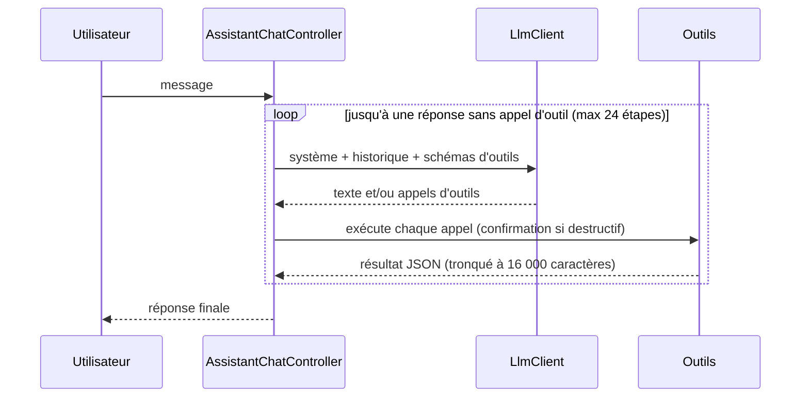

# Degany, l'assistant IA (agent)

[← Documentation développeur](../README.md)

L'onglet Assistant est un agent : il envoie la conversation au LLM choisi par
l'utilisateur, exécute les outils que le modèle appelle (actions réelles de
l'app), renvoie les résultats, et boucle jusqu'à la réponse finale.

## Fichiers

| Fichier | Rôle |
| --- | --- |
| [llm_provider.dart](../../../lib/features/assistant/domain/llm_provider.dart) | Fournisseurs (ChatGPT, Claude, Gemini, DeepSeek, Mistral, Grok, Groq, OpenRouter, Qwen, Ollama, personnalisé) et leur protocole. |
| [chat_message.dart](../../../lib/features/assistant/domain/chat_message.dart) | Messages neutres (texte, appels d'outils, résultats). |
| [llm_client.dart](../../../lib/features/assistant/data/llm_client.dart) | 3 clients HTTP : compatible OpenAI, Claude (Messages API), Gemini. |
| [assistant_config_store.dart](../../../lib/features/assistant/data/assistant_config_store.dart) | Fournisseur, modèle et adresse par fournisseur (`assistant_settings.json`, dossier support de l'app) ; les clés API dans le coffre du système via `flutter_secure_storage`. |
| [user_profile_store.dart](../../../lib/features/assistant/data/user_profile_store.dart) | Mémoire de Degany : profil de l'utilisateur (clé → valeur), en JSON dans le coffre du système (`SecretStore`, clé `influencor.assistant.userProfile`), jamais dans un fichier en clair ; filtre des secrets (`UserProfile.isSecret`). |
| [chat_store.dart](../../../lib/features/assistant/data/chat_store.dart) | Conversations sauvegardées : un fichier par conversation dans `assistant_chats/` (dossier support de l'app), `current.json` pour celle ouverte, 50 au plus ; reprend une fois l'ancien `assistant_chat.json`. |
| [degany_env.dart](../../../lib/features/assistant/data/degany_env.dart) | Modèle fourni au build par `.env` (`DEGANY_*`, voir ci-dessous). |
| [agent_tool.dart](../../../lib/features/assistant/application/agent_tool.dart) | Contrat d'un outil, résolution/sécurité des chemins. |
| [tools/](../../../lib/features/assistant/application/tools/) | Les outils : bibliothèque, Deganeo, tâches/compta/frais, app. |
| [assistant_providers.dart](../../../lib/features/assistant/application/assistant_providers.dart) | Boucle agent, prompt système, état du chat. |
| [assistant_chat.dart](../../../lib/features/assistant/presentation/assistant_chat.dart) | Page du chat : liste, défilement qui suit le streaming, saisie, confirmations. |
| [assistant_transcript.dart](../../../lib/features/assistant/presentation/assistant_transcript.dart) | Rendu façon agent de code : texte pleine largeur avec curseur, bloc de réflexion, actions `● Outil(args)` / `⎿ résultat`, `ToolGroup` (une suite d'au moins deux actions, avec la réflexion entre elles, repliée en « ● N actions · durée » une fois terminée ; `_entries()` de `assistant_chat.dart` fait les regroupements), Markdown léger, liens `[[chemin]]`. |
| [assistant_settings_screen.dart](../../../lib/features/assistant/presentation/assistant_settings_screen.dart) | Réglages : fournisseur, clé, modèle, URL, bouton Enregistrer (en plus de l'enregistrement automatique pendant la saisie), test. Masqués quand le build fixe le modèle. |
| [assistant_history_screen.dart](../../../lib/features/assistant/presentation/assistant_history_screen.dart) | Conversations précédentes (bouton ⟲ à droite de « Nouvelle conversation ») : rouvrir, supprimer. |

## Boucle

## Streaming

Chaque tour du modèle est reçu en flux (SSE) : `LlmClient.stream()` émet
`ThinkingDelta`, `TextDelta`, `ToolCallDelta` puis `ReplyDone` (le tour
complet). Le contrôleur met à jour l'élément en cours à chaque morceau ; un
client qui ne sait pas streamer hérite d'une version « un seul morceau ».

La réflexion s'affiche quand le fournisseur l'expose : Claude (réflexion
adaptative, `display: "summarized"`), Gemini 2.5+ (`includeThoughts`),
DeepSeek / Qwen (`reasoning_content`), OpenRouter / Groq / Ollama
(`reasoning`). OpenAI ne renvoie pas sa réflexion par cette API.

Si la réponse est coupée par la limite de longueur pendant l'écriture d'une
action, l'action n'est pas exécutée (arguments incomplets) et le modèle en
est informé.

## Protocoles

- **Compatible OpenAI** (`/chat/completions`, `tools`/`tool_calls`) : OpenAI,
  DeepSeek, Mistral, xAI, Groq, OpenRouter, Qwen, Ollama, et tout service
  compatible via « Autre ». Pas de `max_tokens`/`temperature` (refusés par
  certains modèles récents).
- **Claude** (`/v1/messages`, `tool_use`/`tool_result`) : les blocs du modèle
  (dont les blocs de réflexion) sont renvoyés tels quels ; tous les résultats
  d'un tour partent dans un seul message `user`. Pour Opus 5.5 / Opus 5 /
  Sonnet 5.5 / Fable 5.1 sur `api.anthropic.com`, le repli serveur
  `fallbacks: "default"` (en-tête `server-side-fallback-2026-07-01`) relance une
  demande refusée par un classifieur sur un autre modèle Claude.
- **Gemini** (`:generateContent`, `functionCall`/`functionResponse`) : les
  `parts` sont renvoyées telles quelles (signatures de pensée) ; les schémas
  sont convertis au sous-ensemble OpenAPI de Gemini.

`ChatMessage.raw` garde la forme native d'un tour assistant par protocole : le
même fournisseur la reçoit à l'identique, un autre fournisseur reconstruit le
tour depuis les champs neutres (on peut changer de modèle en cours de
conversation).

## Outils

| Domaine | Outils |
| --- | --- |
| Bibliothèque | `workspace_overview`, `list_folder`, `search_library` (nom, tags, contenu des notes et tableaux), `list_tags`, `get_item_info`, `create_folder`, `rename_item`, `move_items`, `duplicate_item`, `set_favorite`, `set_tags` |
| Notes / tableaux | `read_note`, `create_note`, `edit_note`, `read_table`, `create_table`, `edit_table` |
| Corbeille | `move_to_trash`, `list_trash`, `restore_from_trash`, `delete_forever` |
| Deganeo | `deganeo_inspect`, `deganeo_clean` (`save` : `copy` à côté de l'original, `replace`, `library` + `folder`), fichiers du dossier de travail uniquement |
| Tâches | `list_tasks`, `get_task`, `create_task`, `update_task`, `delete_task` |
| Comptabilité | `list_transactions`, `accounting_summary`, `add_transaction`, `update_transaction`, `delete_transaction` |
| Frais mobile money | `mobile_money_fees`, `list_fee_tariffs` |
| Conversation | `ask_user` : question avec choix en boutons, attend la réponse (bouton ou texte tapé) |
| Mémoire | `update_user_profile` : ajoute / corrige / retire des faits sur l'utilisateur (outil silencieux, voir ci-dessous) |
| App | `open_item`, `open_screen`, `get_settings`, `update_settings`, `copy_to_clipboard`, `share`, `fetch_web_page` |

Ajouter un outil : créer un `AgentTool` dans le fichier du domaine et
l'ajouter à `agentToolsProvider`. Un outil qui détruit ou remplace des données
renseigne `confirm` (la question affichée à l'utilisateur).

## Mémoire (profil de l'utilisateur)

`userProfileProvider` (`UserProfileController`) charge le profil depuis
`UserProfileStore` ; `send()` l'attend, puis `_memoryPrompt()` le place dans le
prompt système à chaque tour, avec les consignes : le tenir à jour sans le
commenter, répondre aux questions de l'utilisateur sur lui-même depuis ce
profil ou en cherchant dans la bibliothèque, ne garder que des faits sur
l'utilisateur, jamais de secrets ni de données sensibles, et répondre
honnêtement si l'utilisateur demande ce que Degany retient.

- `update_user_profile` est dans `silentTools` : pas de ligne d'action dans le
  chat ni dans les groupes repliés, pas d'étiquette « en préparation ».
- Les clés sont normalisées (`Page Facebook` → `page_facebook`) ; 80 faits de
  500 caractères au plus. Les secrets (mot de passe, PIN, carte validée par
  Luhn, clé `sk-…`) sont refusés côté app, quoi que demande le modèle.
- Coffre indisponible : le profil vit pour la session seulement, rien n'est
  écrit en clair.
- `AssistantConfig.memory` (réglage, activé par défaut) : désactivée, l'outil
  n'est pas proposé et le profil n'est pas envoyé. « Effacer la mémoire »
  appelle `UserProfileController.clear()`. « Nouvelle conversation » garde
  le profil.
- Le profil part chez le fournisseur avec chaque requête : la politique de
  confidentialité (dépôt `influencor-web`) doit le mentionner.

## Pièces jointes et questions

Le trombone de la zone de saisie (ou un glisser-déposer sur ordinateur)
joint des fichiers au message. Seuls les fichiers du dossier de travail sont
acceptés : le sélecteur (`AppFilePicker.pick(root: …)`, galerie ou navigateur
de l'app sur toutes les plateformes) s'ouvre dans le dossier de travail et ne
peut pas en sortir ; un fichier glissé d'ailleurs est ignoré avec un message
(`isInWorkspace`, [workspace_providers.dart](../../../lib/core/providers/workspace_providers.dart)),
et `send()` refiltre les pièces jointes. Le modèle les reçoit sous
`[Fichiers joints par l'utilisateur]` avec leur chemin relatif au dossier de
travail.

`ask_user` ajoute une carte de question au chat et suspend l'outil jusqu'à la
réponse ; tant qu'elle attend, la zone de saisie envoie la réponse au lieu
d'un nouveau message. Le prompt système demande de l'utiliser pour les
décisions de l'utilisateur, notamment l'emplacement des fichiers nettoyés.

## Sécurité

- Degany ne travaille que dans le dossier de travail actuel. Les chemins sont
  relatifs à sa racine ; `resolve()` refuse toute sortie (`..`, chemin absolu
  extérieur, lien symbolique qui mène dehors, y compris pour un fichier à
  créer) et le dossier `.clipboard`. Aucun outil n'accepte un chemin de
  l'appareil hors du dossier de travail (il n'y a plus d'`import_files` :
  l'import se fait par l'utilisateur, depuis la bibliothèque).
- Corbeille, suppression définitive, suppression de tâche/opération et
  remplacement d'un original par Deganeo demandent confirmation (désactivable
  dans les réglages de l'assistant).
- `edit_note` (remplacement) et les suppressions dans `edit_table` placent une
  copie de l'ancienne version dans la corbeille.
- Les clés API restent sur l'appareil, dans le coffre du système : Keystore
  (Android), Trousseau (iOS/macOS, autorisation `keychain-access-groups`),
  DPAPI (Windows), libsecret (Linux). Les clés écrites en clair par une
  ancienne version sont migrées au chargement. Si le coffre est indisponible,
  elles retombent dans le fichier de réglages pour que Degany fonctionne.
- Windows : la partie Windows de `flutter_secure_storage` est remplacée
  (`dependency_overrides`) par
  [third_party/flutter_secure_storage_windows](../../../third_party/flutter_secure_storage_windows/),
  copie de la version 4.1.0 sans son plugin C++ (qui exige le composant ATL de
  Visual Studio). Le stockage DPAPI, en Dart FFI, est inchangé.
- Les messages vont directement au fournisseur choisi.

## Modèle fourni par l'app (`.env`)

`.env` (non versionné, modèle dans `.env.example`) est passé au build par
`--dart-define-from-file=.env` : les scripts `tools/build_*_release.ps1` le
font quand le fichier existe, Codemagic l'écrit depuis la variable secrète
`DEGANY_DOTENV`. En développement : `flutter run --dart-define-from-file=.env`.

| Variable | Rôle |
| --- | --- |
| `DEGANY_USER_MODELS` | `true` (défaut) : chacun connecte son fournisseur, sa clé et son modèle ; le modèle du `.env` sert tant qu'il n'a rien de prêt. `false` : ces réglages sont masqués (réglages, écran d'accueil, sous-titre des Réglages) et Degany utilise toujours le modèle du `.env`. |
| `DEGANY_PROVIDER` | `openai`, `anthropic`, `gemini`… (nom de `LlmProviderKind`). Vide = pas de modèle fourni. |
| `DEGANY_MODEL`, `DEGANY_API_KEY`, `DEGANY_BASE_URL` | Vide = valeurs par défaut du fournisseur. |

`DeganyEnv.apply` calcule la configuration utilisée (`assistantConfigProvider`) ;
l'écran de réglages édite toujours celle de l'utilisateur
(`assistantConfigControllerProvider`) et n'affiche jamais la clé du build.
Les builds web ne reçoivent pas le `.env` : la clé serait lisible par tout
visiteur. Dans un APK / EXE elle reste extractible : clé dédiée, avec plafond
de dépenses.

## Conversation et contexte

La conversation (affichage + historique envoyé au modèle) est sauvegardée à la
fin de chaque échange et restaurée au lancement. « Nouvelle conversation » en
démarre une vide et garde la précédente dans l'historique ; le bouton
historique de l'en-tête (`assistant-history`) liste les conversations, et
`AssistantChatController.open(id)` en rouvre une là où elle s'était arrêtée
(arrête d'abord ce qui tourne dans celle affichée), `delete(id)` la supprime.
Le titre est le premier message de l'utilisateur. Avant chaque envoi, l'historique est ramené sous ~240 000 caractères
(~60 000 tokens) : les anciens résultats d'outils sont raccourcis, puis les
plus anciens échanges retirés, toujours entiers. Les blocs de réflexion des
fournisseurs ne sont alors plus rejoués (historique modifié) ; une note
l'indique dans le chat.

Les messages et erreurs de l'interface sont traduits (fr/en/mg). Les messages
d'erreur des outils, destinés au modèle, restent en français, et les erreurs
renvoyées par un fournisseur sont affichées telles quelles.

## Tests

[assistant_agent_test.dart](../../../test/assistant_agent_test.dart) : boucle
avec un faux modèle, confirmations, chemins interdits, tâches/compta, et
format des requêtes Claude / OpenAI / Gemini (`MockClient`).
