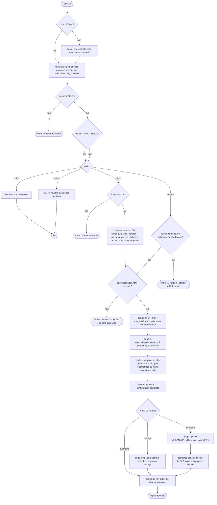

# `start.sh` — étapes et commandes

[← Documentation développeur](../README.md)

`start.sh` publie la version **web** d'Influencor (`build/web`) sur un serveur Mi Kandra : il démarre un nginx Docker qui sert le site et le fait cohabiter avec les autres stacks du serveur. Il ne construit ni l'application Android ni l'installateur Windows : voir [Builds](../build/builds.md).

> **Retirée de `influencor.mi-kandra.org`.** Ce domaine sert désormais le site vitrine et
> les téléchargements (dépôt [`influencor-web`](https://github.com/MorlonDev261/influencor-web)).
> L'app web Flutter n'est servie que sur les domaines ajoutés avec `./start.sh --domain-add` :
> `start.sh` refuse de démarrer sans domaine, et refuse `influencor.mi-kandra.org`. Sur un serveur
> où elle tourne encore sur ce domaine : `./start.sh --stop`, puis lancer `influencor-web`.

Le contexte (domaine, ports, fichiers) est décrit dans [Web : app Flutter](./web-mi-kandra.md).

## Ce que fait `./start.sh`



Modes de cohabitation, détectés par `scripts/edge/mi-kandra-edge.sh` :

| Mode | Situation |
|---|---|
| Autonome | Les ports 80 et 443 sont libres : le nginx d'Influencor les publie lui-même. |
| Partagé | Un routeur Mi Kandra est actif : Influencor s'y enregistre, sans conflit de ports. |
| En attente | 80/443 sont pris par un voisin non converti : lancer `adopt` pour le convertir. |
| Isolé | Choix « autonome » alors que 80/443 sont pris : loopback seulement, rien n'est converti. |

## Commandes

| Commande | Description |
|---|---|
| `./start.sh` | Démarre nginx, qui sert `build/web`, et cohabite avec les autres stacks. Exige un `build/web` existant. |
| `./start.sh --build` | Construit d'abord le site (`flutter build web --release --no-wasm-dry-run`), puis démarre. Le site en ligne reste servi pendant le build (`build/web` mis de côté dans `build/web.prev`) ; un build raté le remet en place. nginx est redémarré à la fin pour servir le nouveau build. |
| `./start.sh --stop` | Arrête le conteneur (`docker compose down`). |
| `./start.sh --status` | État Mi Kandra (mode, routes) puis sonde du lien public de chaque domaine. |
| `./start.sh --domains` | Liste les domaines, l'origine de leur certificat (manuel, letsencrypt, ancien, aucun) et l'expiration réellement servie. |
| `./start.sh --domain-add <domaine> [--force]` | Ajoute un domaine **à chaud** (voir ci-dessous). `--force` ignore le contrôle DNS. |
| `./start.sh --domain-remove <domaine> [--purge]` | Retire un domaine à chaud. `--purge` supprime aussi son certificat Let's Encrypt. |
| `./start.sh --renew` | Renouvelle les certificats Let's Encrypt proches de l'expiration, puis recharge nginx. À planifier (cron quotidien). |

Toute autre option est refusée (`option inconnue`). Il n'y a pas d'option `--help` : l'en-tête du script fait office d'aide.

## Domaines et certificats (à chaud)

Les domaines vivent dans `nginx/sites/domains.list` (un par ligne, non versionné) ; chaque domaine a son vhost
généré `nginx/sites/<domaine>.conf`. Ajouter ou retirer un domaine **ne redémarre jamais le conteneur** :
nginx est rechargé (`nginx -s reload`, sans coupure) et le routeur partagé relit la liste dans le conteneur
(label `org.mi-kandra.domains-file`).

`--domain-add` enchaîne : contrôle DNS (`mi-kandra-dns.sh check`) → vhost HTTP + rechargement → route dans le
routeur partagé → test HTTP-01 local puis public → certificat Let's Encrypt (certbot en conteneur, webroot
`nginx/acme/`) → vhost HTTPS + rechargement → vérification HTTPS avec chaîne de certificats validée.
Au moindre échec, retour arrière complet : le domaine n'est pas ajouté.

Certificat d'un domaine, par priorité :

1. `nginx/certs/<domaine>/fullchain.pem` + `privkey.pem` (manuel, ex. Cloudflare Origin Certificate) ;
2. Let's Encrypt (`nginx/letsencrypt/live/<domaine>/`, émis par `start.sh`) ;
3. l'ancien certificat unique `nginx/certs/fullchain.pem`, s'il couvre le domaine.

Variables `.env` : `LETSENCRYPT_EMAIL` (alertes d'expiration), `LETSENCRYPT_STAGING=1` (autorité de test).

Renouvellement, par exemple dans la crontab root :

```bash
17 3 * * * /chemin/influencor/start.sh --renew >/dev/null
```

> Mise à niveau : le premier `./start.sh` après cette version recrée une fois le conteneur (nouveaux
> volumes et label) ; ensuite, plus aucun redémarrage pour les domaines. Domaine derrière Cloudflare
> (nuage orange) : désactivez « Always Use HTTPS » le temps d'émettre le certificat, ou utilisez un
> certificat d'origine Cloudflare dans `nginx/certs/<domaine>/`.

## Sous-commandes du routeur (`scripts/edge/mi-kandra-edge.sh`)

Ce script est **identique dans tous les projets Mi Kandra** (poma-original, mga-follow-up-v1, ArTest, Influencor). `start.sh` en appelle `choose`, `env`, `status`, `sync` et `adopt`.

| Sous-commande | Description |
|---|---|
| `env` | Affiche les `export` de ports de publication selon le mode détecté, à injecter avant `docker compose`. |
| `status` | État du routeur, des origins détectés et des routes. |
| `sync` | (Ré)enregistre dans le routeur tous les origins en marche. |
| `register` | Idem, limité au projet courant. |
| `unregister <projet>` | Retire les routes d'un projet. |
| `ensure-edge` | Démarre le routeur d'entrée (nécessite 80/443 libres). |
| `adopt [--yes] [--pull]` | Convertit les voisins qui publient déjà 80/443, démarre le routeur puis synchronise (coupure de quelques secondes). `--pull` met d'abord à jour les voisins trop anciens. |
| `choose` | Premier démarrage : demande comment cohabiter (cohabiter, autonome, plus tard) et mémorise le choix. `--reset` repose la question. |
| `doctor [--probe]` | Diagnostic complet ; `--probe` sonde chaque domaine en HTTPS et l'expiration du certificat. |

La sonde du lien public utilise `scripts/edge/mi-kandra-dns.sh probe <domaine>`.

## Fichiers liés

| Fichier | Rôle |
|---|---|
| `start.sh` | Orchestrateur décrit ci-dessus. |
| `docker-compose.yml` | nginx durci, labels `org.mi-kandra.*`. |
| `nginx/templates/influencor.conf.template` | Serveurs par défaut, puis `include` des vhosts de `nginx/sites/`. |
| `nginx/snippets/influencor-app.conf` | Corps commun des vhosts HTTPS (en-têtes, cache, repli SPA). |
| `nginx/snippets/acme-challenge.conf` | Sert les jetons HTTP-01 de Let's Encrypt. |
| `nginx/sites/` | Générés : `domains.list` et un vhost par domaine (jamais versionnés). |
| `nginx/certs/` | Certificats manuels, `nginx/certs/<domaine>/` (jamais versionnés). |
| `nginx/letsencrypt/`, `nginx/acme/` | Certificats Let's Encrypt et webroot HTTP-01 (jamais versionnés). |
| `scripts/edge/` | Routeur partagé, sonde DNS, sauvegardes ; seul `project.env` diffère entre projets. |
| `.env.example` | `LETSENCRYPT_EMAIL`, `LETSENCRYPT_STAGING`, ancien `INFLUENCOR_DOMAIN` et chemins de l'ancien certificat. |
